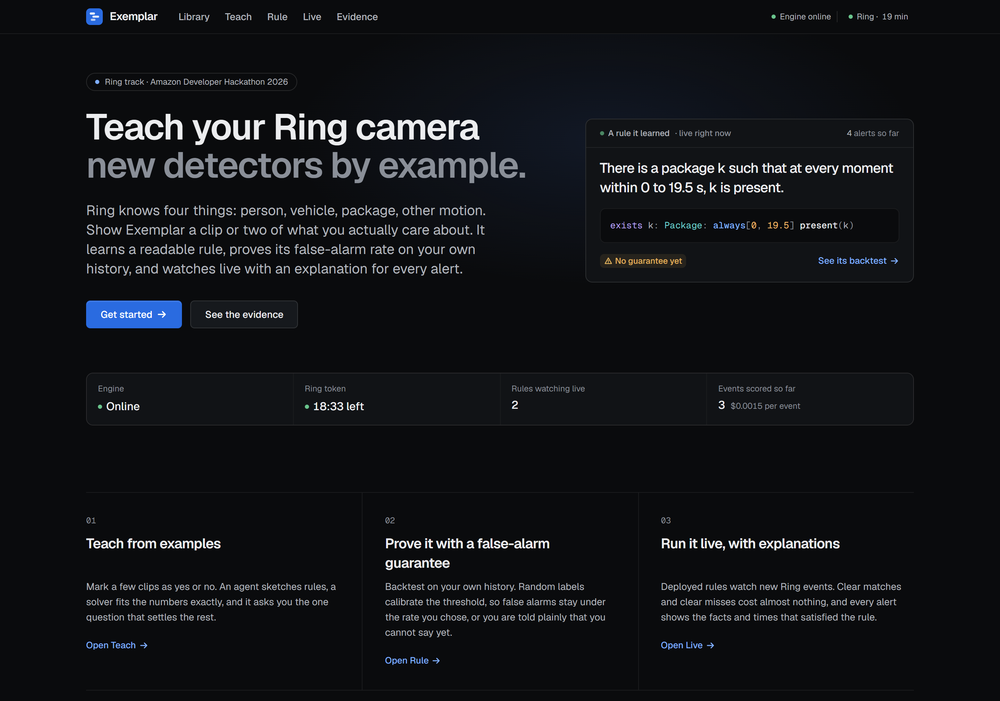
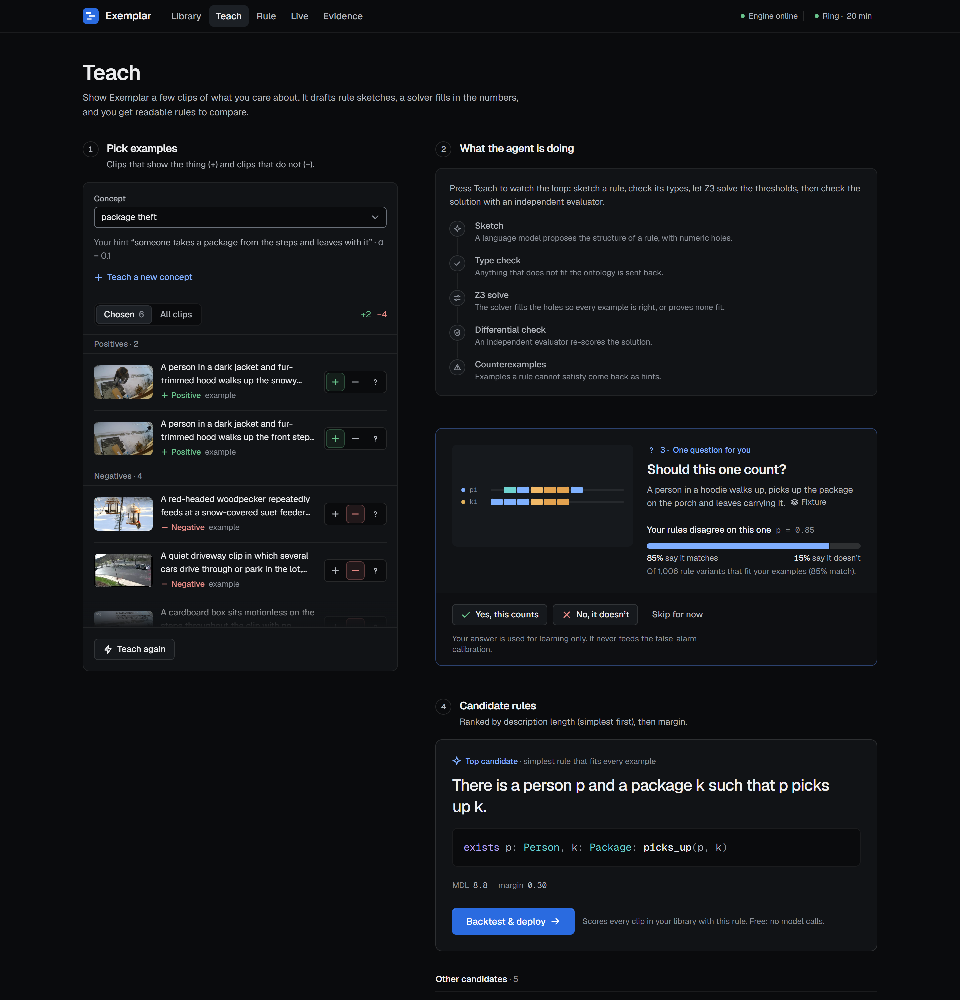
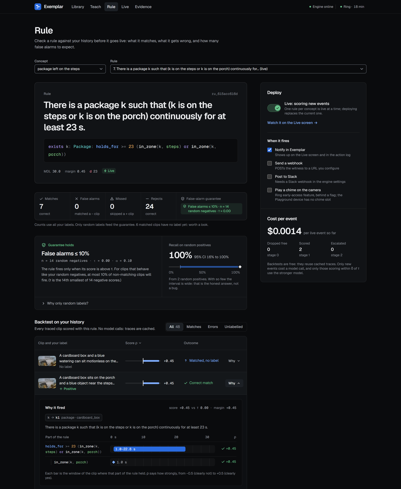
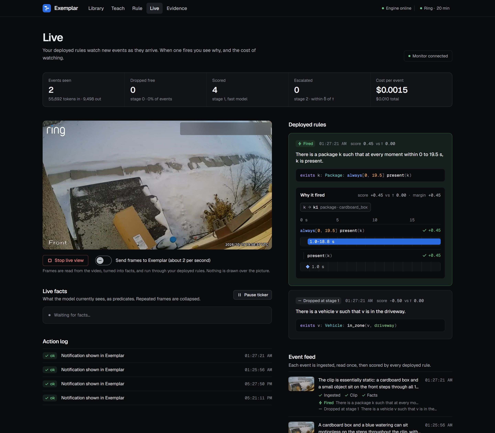
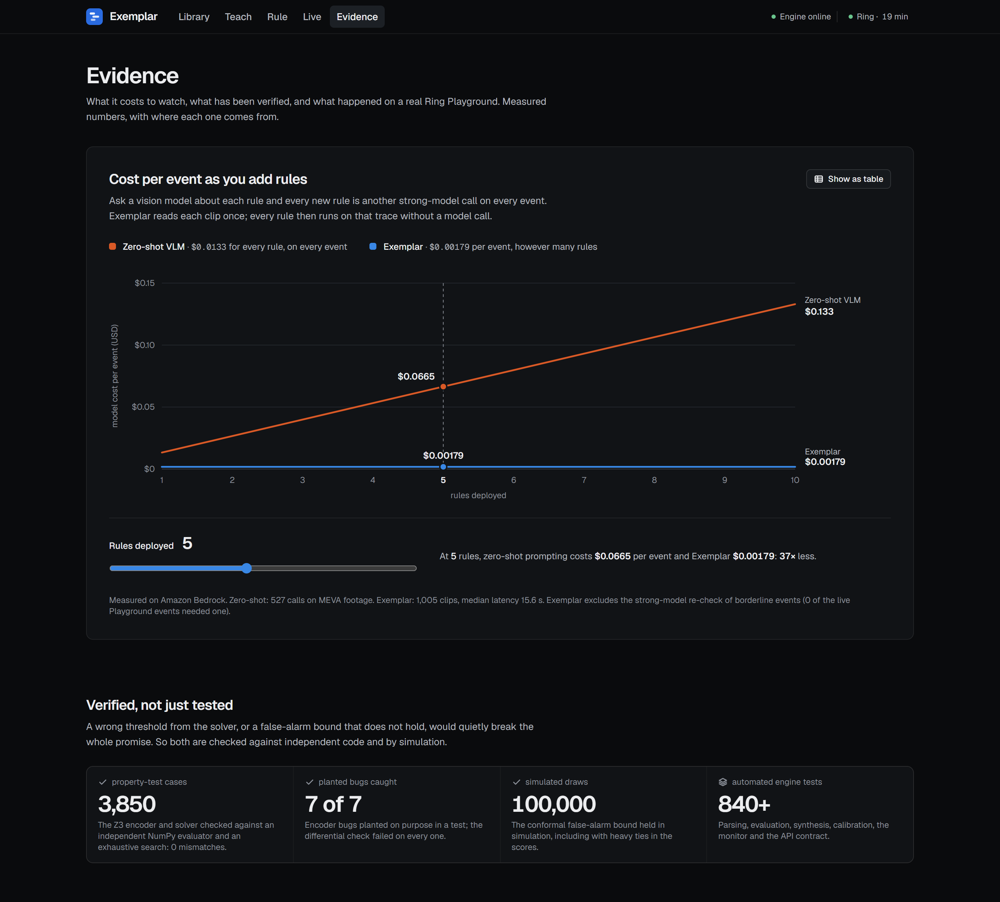
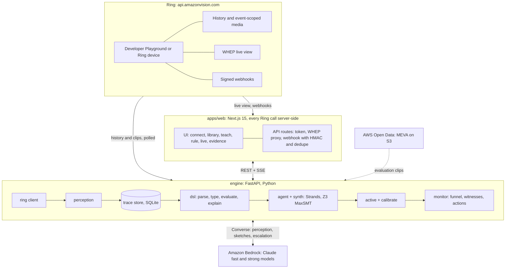

# Exemplar: teach your Ring camera new detectors by example

> Show a Ring camera one or two clips of what you care about, and it learns a readable rule, proves it on your history with a statistical false-alarm guarantee, and watches for it live, explaining every alert.

Every household cares about something different. People's real questions are specific: "a package was taken by someone who didn't deliver it", "a car has been idling at my loading dock for two minutes". **Exemplar lets you teach those by example.** An LLM reads each clip once and turns it into symbolic facts; a Strands agent proposes rule sketches in a small temporal-logic language; the Z3 solver fills in the exact numbers; and a conformal calibration step puts a guarantee on how often the rule may cry wolf. Then the rule runs on live Ring events, and each alert shows the timeline of facts that triggered it.

Entry for the Amazon Developer Hackathon 2026: **Ring** track, **AWS Builder** mini challenge.

## Highlights

- **A live loop on the Ring Developer Playground.** Paste a Playground token, click Simulate in the Playground, and the engine polls Ring history, downloads each event's clip, perceives it and scores the deployed rules. In our run, a taught package rule fired only on the package event, a vehicle rule only on the vehicle event, and the bird events fired neither, at about $0.0015 per watched event.
- **Teach by example, in seconds.** From Playground clips, the agent and Z3 produced rules such as *"There is a package k such that at every moment within 0 to 19.5 s, k is present"* and *"There is a vehicle v such that v is in the driveway"* in 15 to 21 s. When perception called the same box "porch" instead of "steps" and the first rule missed, one more labelled example and a 21 s re-teach produced a rule that does not care which.
- **It asks one good question.** From a committee of 1,206 consistent rules, Exemplar picked the clip they disagreed on most (the theft window of the "Thief stealing our package" footage, p = 0.50) and asked "should this one count?".
- **Every alert is explained.** The rule is shown in plain English by a deterministic printer (an LLM never paraphrases it), and each firing carries a witness: which entities, which moments, how much margin.
- **A calibrated false-alarm guarantee.** The threshold is set from randomly sampled labels with conformal prediction, so the false-alarm rate is at most the chosen alpha for exchangeable events. Actively chosen labels are kept out of calibration because they would void the guarantee.
- **Cost that does not grow with the number of rules.** Perception runs once per event and every rule is scored on the cached trace in about 0.05 to 0.1 ms with no model call ([chart below](#cost-per-event-as-rules-are-added)).
- **Engineering rigor.** Differential testing of the solver encoding, property tests of the logic, a 100,000-draw simulation of the conformal bound, signed-webhook fixtures, and an accessibility scan ([details](#tests-and-verification)).

## Screenshots

<!-- The five files below are captured from the running app; keep these exact names. -->
| | |
|---|---|
|  |  |
| **Home** | **Teach**: sketches proposed, Z3 solving, counterexamples, one question |
|  |  |
| **Rule**: backtest, witness timelines, false-alarm guarantee, Deploy | **Live**: Playground view, fact ticker, rules lighting up with explanations |
|  | |
| **Evidence**: cost scaling and verification | |

## Architecture



**Key principle:** perception runs once per clip and its output (the trace) is cached. Synthesis, backtesting, active learning, calibration and live scoring all work on traces only, which makes them fast, cheap, repeatable and testable without a model.

## How it works

1. **Perceive** (`engine/exemplar/perception/`). A fast Claude model on Amazon Bedrock reads 16 frames sampled from a clip and answers through forced tool use with a JSON schema: entities (person, vehicle, package, animal, object) and per-frame facts such as `present`, `in_zone(e, steps)`, `carrying(p, k)`, `picks_up(p, k)`, each with a confidence. Output is validated against a typed ontology and retried once with the error message if needed.
2. **Trace** (`engine/exemplar/store/`). The facts become a symbolic trace in SQLite, keyed by event, sampling parameters and prompt version. A fact's confidence is its signal value: 0.95, 0.8 or 0.6 when asserted, 0.05 when not.
3. **Sketch** (`engine/exemplar/agent/`). A Strands agent on the strong model sees the labelled traces and proposes rule sketches in a small temporal-logic DSL with numeric holes, for example `picks_up(p, k) then[?a, ?b] leaves(p, porch)`. Every sketch is typechecked; errors go back to the agent.
4. **Solve** (`engine/exemplar/synth/`). Z3 fills the holes exactly. It is a MaxSMT problem: satisfy as many labelled examples as possible (so a noisy perception does not make the rule impossible), then maximise the margin. Examples that cannot be satisfied are surfaced as "perception suspect?". The agent loops on counterexamples (CEGIS), and candidates are ranked by description length so the simplest consistent rule wins. Every solved rule is re-evaluated by an independent NumPy evaluator; a disagreement raises.
5. **Score** (`engine/exemplar/dsl/`). A rule returns a real-valued robustness (Signal Temporal Logic): not just yes or no, but how strongly it held. The semantics are specified operator by operator in [`docs/DSL.md`](docs/DSL.md). The robustness margin drives max-margin rule choice, the escalation band and calibration.
6. **Ask** (`engine/exemplar/active/`). The surviving rules form a version space. Exemplar samples a committee from it and asks about the unlabelled clip with the greatest disagreement.
7. **Prove** (`engine/exemplar/calibrate/`). The threshold is the k-th smallest score among randomly sampled negatives, with k = ceil((n+1)(1-alpha)); the rule fires only above it. For exchangeable events, the false-alarm probability is at most alpha. Recall is reported with a Clopper-Pearson interval. If there are too few random negatives, the UI says so instead of showing a guarantee badge.
8. **Run** (`engine/exemplar/monitor/`). For each new event: stage 0 drops events whose Ring `sub_type` makes the rule impossible (free), stage 1 perceives and scores, stage 2 re-perceives borderline events with the strong model. A firing carries its witness (bindings, the moments chosen for each temporal operator, the margin) and runs actions: UI notification, optional Slack or webhook-out, and Chime playback behind a flag.

## Ring API usage

All Ring calls are server-side. The engine is the main Ring client (`python -m exemplar.api` starts its history poller); the web app handles the browser-facing parts (token paste, WHEP proxy, webhook receiver).

| Ring API | Use in Exemplar | Code |
|---|---|---|
| Developer Playground token (30 min, read-only) | the demo environment; pasted on the Connect screen, held server-side, never sent back to the browser | `apps/web/app/api/ring/token/route.ts`, `engine/exemplar/ring/tokens.py` (`PlaygroundToken`) |
| OAuth app mode: authorization code with PKCE, rotating refresh tokens, account linking, `app-integrations` | the production auth path (exercised by mocked-HTTP tests; the Playground has no OAuth client) | `engine/exemplar/ring/tokens.py` (`OAuthApp`), `engine/exemplar/api/routes/ring.py` |
| `GET /v1/users/me` | verify the connection | `engine/exemplar/ring/client.py` (`verify_connection`) |
| `GET /v1/devices?include=status,capabilities,configurations`, `…/location` | device discovery, status, local time zone | `client.py` (`list_devices`, `device_location`) |
| `GET /v1/history/devices/{id}/events`: cursor pagination, `event_types` filters | the event poller (every 15 s) and backtests over history | `client.py` (`history`, `history_tagged`), `engine/exemplar/api/ingest.py` |
| `POST /v1/devices/{id}/media/video/download` | the clip for perception; waits for clip end + 5 s, retries 416 and 425 with backoff for about 2 minutes, follows the 303 to the pre-signed URL without the bearer token | `client.py` (`download_video`, `_media`) |
| `POST /v1/devices/{id}/media/image/download` | thumbnails | `client.py` (`download_snapshot`) |
| `POST /v1/devices/{id}/media/streaming/whep/sessions` | live view in the browser, with 2 fps frame capture feeding a live fact ticker; the session `DELETE` is restricted to Ring's origin | `apps/web/app/api/ring/stream/route.ts`, `apps/web/app/hooks/useWebRTCStream.ts`, `apps/web/lib/video-processors/frame-grab.ts`, `engine/exemplar/api/live.py` |
| Webhooks | `X-Signature` HMAC-SHA256 over the raw body with a constant-time compare; 200 within Ring's 5 s window; deduplicated on `meta.request_id`; `app_integration_added` and `_removed` handled; forwarded to the engine | `apps/web/app/api/ring/webhook/route.ts`, `apps/web/lib/ring/webhook-verify.mjs`, `webhook-delivery.mjs`, `engine/exemplar/ring/webhook.py`, replay tool `scripts/send_signed_webhook.py` |
| `POST /v1/devices/{id}/media/audio/playback` (early access) | Chime as a rule action, behind `EXEMPLAR_CHIME_ENABLED` (the Playground device has no chime slots and answers 400) | `client.py` (`chime_play`), `engine/exemplar/monitor/actions.py` |
| Ring Appstore MCP docs server | used by our coding assistant while writing the client (`https://knowledge.appstore-mcp.ring.amazon.dev/mcp`, tools `search_docs` and `get_doc`) | development only |

The client retries 429 (`Retry-After`), 500, 503 and transport errors with backoff, never retries 406 (IP block) or 403, and refreshes the token once on a 401 when the provider can.

## AWS usage (AWS Builder)

| Service | What it does here | Code |
|---|---|---|
| **Amazon Bedrock, Claude (fast model)** | per-clip perception through the Converse API: 16 frames in one request, forced tool use with a JSON schema | `engine/exemplar/perception/` |
| **Amazon Bedrock, Claude (strong model)** | the reasoning in the synthesis agent, and re-perception of events near a rule's decision boundary (up to 32 frames) | `engine/exemplar/agent/llm.py`, `engine/exemplar/monitor/` |
| **Strands Agents SDK** | the counterexample-guided synthesis agent: `Agent` + `BedrockModel` + tools `typecheck`, `solve_sketch`, `evaluate`, `fetch_counterexamples`, `submit_sketches` | `engine/exemplar/agent/` |
| **Application inference profiles** | both models are addressed from `.env` (`CLAUDE_AWS_MODEL`, `CLAUDE_AWS_FAST_MODEL`); we use application inference profile ARNs, and no model id is in the code | `engine/exemplar/settings.py` |
| **AWS Open Data (MEVA on S3)** | anonymous S3 access to real outdoor surveillance video and annotations (Kitware, IARPA, CC BY 4.0) for evaluation data | `eval/data/` |

Details on how each service is used, what worked and what we would change are in [`docs/FEEDBACK.md`](docs/FEEDBACK.md#5-aws-services-used-in-detail).

### Cost per event as rules are added


Exemplar perceives an event once ($0.00179 on average over 1,005 clips, p50 latency 15.6 s) and scores any number of rules on the cached trace. Prompting a vision model per rule costs $0.0133 per rule per event on the same frames, so ten rules cost about 74 times as much. Numbers and method: [`docs/eval/cost_vs_rules.md`](docs/eval/cost_vs_rules.md); regenerate with `uv run --project engine python eval/plots/cost_vs_rules.py`.

## Quick start

You need [uv](https://docs.astral.sh/uv/) (it installs Python 3.11+ for you), Node 20 or newer, Chrome, an AWS account with Amazon Bedrock access to two Claude models (one fast, one strong), and a free [Ring Developer Playground](https://developer.amazon.com/ring/console/playground) account. Commands are the same on Windows (Git Bash or PowerShell), macOS and Linux unless noted. ffmpeg is bundled through `imageio-ffmpeg`, so nothing else needs installing.

**No Bedrock keys yet?** Leave every `CLAUDE_AWS_*` value empty, and `RING_*` and `OPENAI_API_KEY` too (the Ring token is pasted in the UI, and OpenAI is only used to narrate a demo video). Without Bedrock these work: the 12 example traces (`seed --fixtures`, step 3), Teach (an offline template proposer stands in for the Claude agent; Z3 solving, ranking and the question card are unchanged), the Rule screen (backtest, witnesses, calibration, Deploy), the Evidence screen, and all the tests (the ones that call Bedrock or Ring skip themselves). Reading new clips needs Bedrock: Playground events and uploads then show *"Can't read clips: Amazon Bedrock isn't configured. Set CLAUDE_AWS_* in .env."* in the Library, and are read after you add the keys and restart the engine.

```bash
# 1. Configuration: Bedrock credentials and the two models. The Ring token is pasted in the UI later.
cp .env.example .env            # PowerShell: copy .env.example .env
#    fill in CLAUDE_AWS_ACCESS_KEY, CLAUDE_AWS_SECRET_KEY, CLAUDE_AWS_REGION,
#    CLAUDE_AWS_MODEL (strong), CLAUDE_AWS_FAST_MODEL (fast), CLAUDE_AWS_MODEL_ALIAS (a display name)

# 2. Engine (Python): create the environment in engine/.venv
#    Windows only: set PYTHONUTF8=1 (PowerShell: $env:PYTHONUTF8 = "1") so Python reads and writes UTF-8
uv sync --project engine

# 3. Optional: load 12 hand-written example traces so every screen has data before you connect (no model calls)
uv run --project engine python -m exemplar.api.seed --fixtures

# 4. Start the engine on http://127.0.0.1:8787
uv run --project engine python -m exemplar.api
```

`CLAUDE_AWS_MODEL` and `CLAUDE_AWS_FAST_MODEL` each take a Bedrock model ID, an inference profile ID or an ARN (we use application inference profile ARNs); the value goes unchanged into the Converse `modelId`, and the region must be the one that model or profile lives in. Only `CLAUDE_AWS_ACCESS_KEY`, `CLAUDE_AWS_SECRET_KEY` and `CLAUDE_AWS_REGION` are read for credentials: there is no setting for a session token or an SSO profile, so use an IAM user's long-lived access key (temporary STS or SSO credentials will not work).

In a second terminal:

```bash
# 5. Web app (Next.js) on http://localhost:3000; it reaches the engine at ENGINE_URL (default http://127.0.0.1:8787)
cd apps/web
npm ci
npm run dev
```

**Other ports.** The web app: `npm run dev -- -p 3001`. The engine: set `EXEMPLAR_PORT=8788` (and `EXEMPLAR_HOST`, default `127.0.0.1`) before `python -m exemplar.api`; then tell the web server where it is with `ENGINE_URL=http://127.0.0.1:8788` in its environment or in `apps/web/.env.local` (the browser only talks to the web app, which proxies to the engine). With the mock engine, `MOCK_PORT=8788 PORT=3001 npm run dev:mock` sets the mock engine's port and the web port, and points `ENGINE_URL` at the mock. In PowerShell set variables first, for example `$env:EXEMPLAR_PORT = "8788"; uv run --project engine python -m exemplar.api`.

Then:

1. **Connect.** Open <http://localhost:3000/connect>. In the [Ring Developer Playground](https://developer.amazon.com/ring/console/playground) generate a token (valid about 30 minutes) and paste it. A countdown shows the time left; paste a fresh token when it runs out.
2. **Create events.** In the Playground click **Simulate** for a package, a vehicle and a motion event. The engine polls history every 15 s, downloads each clip and perceives it; expect each event in the Library one to two minutes later (the Playground lists an event 27 to 44 s after it starts).
3. **Teach.** Create a concept (for example "a package has been sitting on the steps") under **Teach a new concept**, then in the Library mark the package event as a positive and the others as negatives, and run Teach. Watch the agent's timeline (sketch proposed, Z3 result, counterexamples) and the candidate rules in English and in the DSL. Answer the question card if one appears.
4. **Prove and deploy.** On the Rule screen, label ten random clips for calibration (or use bulk-negative), read the backtest with its witnesses and the false-alarm guarantee, and switch Deploy on. Repeat for a vehicle rule.
5. **Run live.** Click Simulate again. The Live screen shows which rule fired, the witness timeline and the running cost per event. **Start live view** opens the Playground stream in the browser; the Ring watermark is never covered.

**Upload your own footage.** The Library's **Upload footage** button cuts a video into windows and treats them as events. We use it for the package-theft story with the CC BY footage credited below; download that video yourself and upload it there, or place it at `data/external/frollard_thief.mp4` and run `uv run --project engine python -m exemplar.api.seed --frollard`. Without `--no-perceive` that calls Bedrock for every window (results are cached); with `--no-perceive` it only imports the clips and skips Bedrock. If the file is missing the command prints a one-line message and exits with a non-zero status.

**Signed webhooks.** The Playground sends none, so replay signed fixtures instead. The web route reads `RING_WEBHOOK_SIGNING_KEY` from the web app's own environment, so put `RING_WEBHOOK_SIGNING_KEY=exemplar-test-signing-key` in `apps/web/.env.local` (the root `.env` is only read by the engine; without the key the route answers 503 and refuses every delivery), restart the web app, and run `uv run --project engine python scripts/send_signed_webhook.py motion_human` (add `--fresh --sub-type vehicle`, `--repeat 2`, `--tamper` and so on; `--list` shows the fixtures). The script posts to the web app on port 3000 (`http://localhost:3000/api/ring/webhook`); if the web app runs elsewhere, add `--url http://localhost:3001/api/ring/webhook`.

**Useful settings** (environment variables, all optional):

| Variable | Default | Meaning |
|---|---|---|
| `EXEMPLAR_DATA_DIR`, `EXEMPLAR_DB` | `./data`, `<data dir>/exemplar.sqlite3` | where clips, traces and the database live |
| `EXEMPLAR_HOST`, `EXEMPLAR_PORT` | `127.0.0.1`, `8787` | where the engine listens |
| `EXEMPLAR_POLL_INTERVAL_S`, `EXEMPLAR_POLL_ENABLED` | `15`, `1` | Ring history polling |
| `EXEMPLAR_CHIME_ENABLED` | `0` | allow the Chime rule action |
| `EXEMPLAR_SLACK_WEBHOOK_URL`, `EXEMPLAR_WEBHOOK_OUT_URL` | unset | extra rule actions |
| `ENGINE_URL` (web app) | `http://127.0.0.1:8787` | where the web server finds the engine |

## Tests and verification

```bash
uv run --project engine pytest engine/tests            # engine: DSL, solver, calibration, Ring client, API, store
uv run --project engine pytest eval/tests              # evaluation harness and dataset tooling
cd apps/web && node --test lib/ring/ring.test.mjs     # webhook verification and WHEP URL allow-list (22 tests)
cd apps/web && npm run mock:validate                   # exercises every operation of the engine API contract against a mock
```

In PowerShell, run the `cd apps/web` lines as two commands (`cd apps/web`, then the rest), because Windows PowerShell 5.1 has no `&&`. The Node test is given as a file path on purpose: a directory argument (`node --test lib/ring/`) fails on recent Node versions (it does on Node 24), and PowerShell does not expand a `*` glob (Node 21 and later expand it themselves, Node 20 does not).

The heavier checks behind the claims below are opt-in:

```bash
# Z3 encoder vs NumPy evaluator and solver vs exhaustive search, ten times the default number of random cases
# (3,850 generated cases in total, about 5 to 7 minutes; the default scale runs 385)
SYNTH_PROP_SCALE=10 uv run --project engine pytest engine/tests/synth/test_synth_encoding.py engine/tests/synth/test_synth_solve.py
#   PowerShell: $env:SYNTH_PROP_SCALE = "10"; uv run --project engine pytest engine/tests/synth/test_synth_encoding.py engine/tests/synth/test_synth_solve.py

# plants 7 encoder bugs one at a time and checks that the differential test fails on each (about 15 s)
uv run --project engine pytest engine/tests/synth/test_synth_mutations.py

# axe-core scan of every screen against the mock engine. One-time setup (installs into the gitignored mock/.cache/;
# the script launches your installed Chrome headless):
cd apps/web
npm i --prefix mock/.cache/pw playwright-core
npm i --prefix mock/.cache/axe axe-core
npm run dev:mock                 # in one terminal, then in another: node mock/a11y.mjs [http://localhost:3000]
```

Tests that call Bedrock or Ring are skipped unless credentials are present. What the suites establish:

- **The solver encoding is checked against an independent evaluator.** Over 6,000 randomized cases ran during development with 0 mismatches; the deep configuration in the repo (`SYNTH_PROP_SCALE=10`, command above) reproduces 3,850 of them in about 5 to 7 minutes: 2,000 randomly generated sketches compare the Z3 encoding with a NumPy evaluator and 1,850 more compare the solver with an exhaustive search, with no mismatches. 7 of 7 deliberately planted encoder bugs are caught by that comparison (`engine/tests/synth/test_synth_mutations.py`). A third, literal reference implementation of the semantics cross-checks the vectorised evaluator bit for bit (`engine/tests/dsl/`, `engine/tests/synth/`).
- **The logic obeys its laws.** Property tests (Hypothesis) state that the sign of robustness agrees with the boolean result, that negation is an exact duality, and that widening `eventually` and `then` windows never decreases robustness ([`docs/DSL.md`](docs/DSL.md)).
- **The false-alarm bound holds.** `engine/tests/calibrate/test_calibrate_validity.py` checks it exactly on a small discrete distribution and by a 100,000-draw simulation with heavy ties, and shows that a deliberately wrong quantile fails the same check. The conformal rank uses exact rational arithmetic because floating-point `ceil((n+1)(1-alpha))` is off by one for some alpha.
- **Webhooks are verified like production.** Signed, tampered, re-serialised, unsigned and duplicate payloads are tested in both Python and Node against the same fixtures.
- **The API contract is enforced.** `npm run mock:validate` covers 33 of 33 operations, and the engine's test suite checks that every path and method in the contract is served and schema-valid.
- **Accessibility.** The UI targets WCAG 2.2 AA: contrast tokens are checked by `npm run mock:contrast`, and an axe-core scan of every screen reports 0 violations.
- **More than 840 engine tests, 207 evaluation tests and 22 webhook tests** in total.

## Responsible by design

Ring API calls and the Playground token stay on the server; the token is never returned to the browser. Exemplar performs no facial recognition, no cross-property tracking and no life-safety function. The mandatory Ring watermark is never covered in the live view. Rules are explained by a deterministic printer and witnesses, not by an LLM paraphrase.

## Repository layout

| Path | Contents |
|---|---|
| `apps/web/` | Next.js 15 app forked from `AmazonAppDev/ring-api-helloworld`: screens in `app/(exemplar)/`, Ring routes in `app/api/ring/`, engine proxy in `app/api/engine/`, helpers in `lib/ring/` and `lib/video-processors/` |
| `engine/exemplar/ring/` | async Ring client, token providers (Playground and OAuth), webhook verification and dedupe |
| `engine/exemplar/perception/` | frame sampling (ffmpeg), Claude on Bedrock to a validated trace, content cache, escalation |
| `engine/exemplar/dsl/` | parser, typechecker, English printer, boolean and robustness evaluators, witnesses |
| `engine/exemplar/synth/`, `agent/` | Z3 encoding, MaxSMT and margin, MDL ranking; the Strands CEGIS agent |
| `engine/exemplar/active/`, `calibrate/`, `monitor/` | committee and query selection; conformal threshold and recall interval; funnel, witnesses, actions |
| `engine/exemplar/api/`, `store/` | FastAPI routes with SSE, the poller and ingest pipeline, the SQLite store |
| `engine/exemplar/contracts/` | the interfaces between components: trace, DSL grammar, labels, REST and SSE (`api.yaml`), SQL schema |
| `engine/tests/` | engine tests and fixtures (traces, signed webhook payloads) |
| `eval/` | evaluation data tooling (MEVA), harness, cost ledgers and charts ([`eval/README.md`](eval/README.md), [`eval/data/README.md`](eval/data/README.md)) |
| `scripts/` | `send_signed_webhook.py` replay tool; `spikes/` early probes of the Ring, Bedrock, Strands, Z3 and WHEP behaviour |
| `docs/` | [`DSL.md`](docs/DSL.md) (semantics), [`FEEDBACK.md`](docs/FEEDBACK.md), [`FRICTION_LOG.md`](docs/FRICTION_LOG.md), [`DEVPOST.md`](docs/DEVPOST.md), `eval/` (cost chart) |

## Attributions

- `apps/web` is derived from **ring-api-helloworld**, © 2026 Amazon, MIT, forked from commit `76100aa`. See `apps/web/LICENSE` and [`apps/web/UPSTREAM.md`](apps/web/UPSTREAM.md).
- Porch footage: **"Thief stealing our package" by frollard**, <https://www.youtube.com/watch?v=TfTFu8lGrwk>, licensed [CC BY 4.0](https://creativecommons.org/licenses/by/4.0/). It is also the source of the Ring Developer Playground's package clip. We cut it into short windows and do not redistribute it in this repository.
- Evaluation data: **MEVA, Multiview Extended Video with Activities** (Kitware, Inc. and IARPA), [CC BY 4.0](https://mevadata.org/resources/MEVA-data-license.txt), accessed 2026-10-15 from <https://registry.opendata.aws/mevadata>. Corona et al., "MEVA: A Large-Scale Multiview, Multimodal Video Dataset for Activity Detection", WACV 2021. We cut, crop and re-encode windows from it.

## License

MIT. See [LICENSE](LICENSE).
